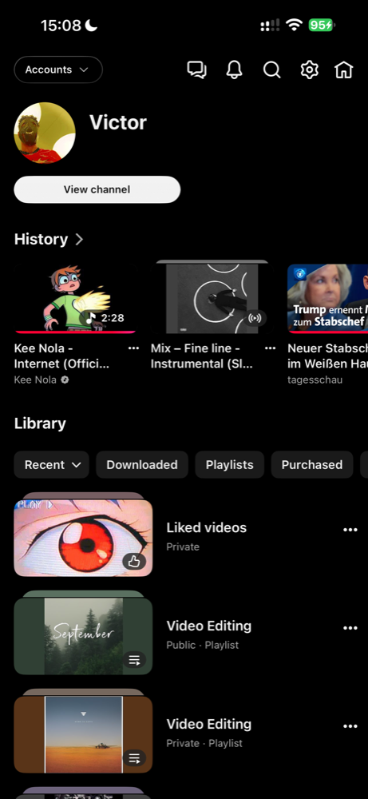

# MinimalNav

A tweak for the iOS YouTube app that hides the bottom tab bar and replaces it with a single profile button in the top bar, next to search. One tap opens your **You** page (history, playlists, downloads), a second tap takes you back to Home.

The result is a YouTube that is just the feed, search and your profile.

<p align="center">
  
  &nbsp;&nbsp;
  
</p>

The left screenshot also shows [IOSGridView](https://github.com/TributeOne/IOSGridView), a separate tweak.

> This tweak was vibe-coded with Claude Opus and Claude Fable: the code was written by the models in conversation, with YouTube's view hierarchy reverse-engineered step by step and every change tested on a real device.

## Features

- Hides the bottom tab bar (pivot bar) permanently, including YouTube's new floating tab bar.
- Adds a round profile button next to the search button. It shows your account avatar, taken from the hidden You tab, so it always matches the signed-in account.
- Tap: switch to You. Tap again: back to Home. The icon changes to a house while you are on the You page.
- On launch the app always starts on Home, even when YouTube restores another tab.
- Toggle in YouTube settings under **MinimalNav** (grouped under *Tweaks* when [YouGroupSettings](https://github.com/PoomSmart/YouGroupSettings) is installed). The toggle takes effect after an app restart.
- Available in English and German.

## Compatibility

- Built for iOS 14 and later, arm64.
- Tested with YouTube 21.42.4 on iOS 27.0.1 (iPhone 15 Pro Max), sideloaded together with [YouMod](https://github.com/Tonwalter888/YouMod) and PoomSmart's tweaks. MinimalNav does not depend on either of them.
- The tweak works with YouTube's real tab items, so it keeps working as long as YouTube keeps a (hidden) tab bar with a Home and a You tab. If a YouTube update breaks it, please open an issue with the YouTube version.

## Installation

**Jailbroken:** install the `.deb` from the [releases](https://github.com/TributeOne/MinimalNav/releases). Packages are provided for rootful, rootless and roothide.

**Sideloaded:** inject `MinimalNav.dylib` from the `.deb` into a decrypted YouTube IPA with a tool such as [cyan](https://github.com/asdfzxcvbn/pyzule-rw), then sign and install the IPA as usual. The tweak can be combined with YouMod or any other YouTube tweak in the same IPA.

## Building

Requires [Theos](https://theos.dev) and [YouTubeHeader](https://github.com/PoomSmart/YouTubeHeader) in `$THEOS/include/YouTubeHeader`.

```sh
make clean package FINALPACKAGE=1
make clean package FINALPACKAGE=1 THEOS_PACKAGE_SCHEME=rootless
make clean package FINALPACKAGE=1 THEOS_PACKAGE_SCHEME=roothide
```

The GitHub Actions workflow in `.github/workflows/build.yml` builds all three packages and attaches them to a draft release for tags starting with `v`.

## How it works

YouTube keeps its tab bar in the view hierarchy even while hidden. MinimalNav remembers the tab items as they appear, reads the Home and You identifiers from YouTube itself, and triggers the same action a finger tap on the hidden tab would trigger. The profile button is added to `YTRightNavigationButtons`, and the other buttons are shifted left to make room.

## Credits

- [PoomSmart](https://github.com/PoomSmart) for YouTubeHeader and YouGroupSettings.
- [Theos](https://theos.dev).

## License

[MIT](LICENSE)
